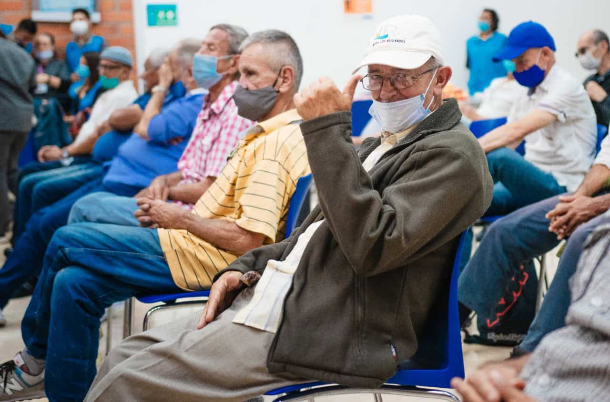

# Introducción

Una enfermedad es un choque incierto sobre el presupuesto del hogar: si el pago directo por atención es elevado frente a los recursos disponibles, compromete el resto de su consumo y se denomina gasto catastrófico cuando supera un umbral (Xu et al., 2003). Sin embargo, el gasto catastrófico es solo el caso extremo de un problema más amplio: un sistema de salud ofrece protección financiera cuando las personas reciben la atención que necesitan sin tener que pagarla de su bolsillo en condiciones que comprometan su bienestar (WHO, 2010).

En Colombia, el riesgo varía según el régimen, el ingreso y la composición del hogar (Amaya-Lara, 2016; Pérez-Valbuena & Silva-Ureña, 2015). Este trabajo estudia qué características de los hogares de La Candelaria (Medellín) se asocian con mayor probabilidad de pagar de bolsillo por salud, con la Encuesta de Calidad de Vida (ECV) de Medellín 2025 (Alcaldía de Medellín, 2026).

Interesan los hogares con menos margen para absorber un gasto médico, pues un mismo pago pesa más sobre un presupuesto reducido. Esa vulnerabilidad varía entre regiones (Amaya-Lara, 2016) y departamentos (Ramírez-Agudelo & Pinilla-Roncancio, 2023); acotar el análisis a una comuna mantiene constante el contexto territorial.

La Candelaria, en el centro de Medellín, debería enfrentar menores barreras geográficas de acceso. Sin embargo, la ECV 2025 la ubica entre los tres territorios con mayor déficit habitacional (Alcaldía de Medellín, 2026), señal de recursos restringidos, y es una de las comunas más envejecidas de la ciudad; resulta apropiada para examinar si la cercanía a los servicios evita el riesgo financiero. La pregunta de investigación es:

> **¿El problema de los hogares de La Candelaria frente al gasto en salud es el caso extremo del gasto catastrófico o una falta más amplia de protección financiera? ¿Qué características aumentan la probabilidad de que un hogar pague de su bolsillo por salud, y qué papel cumple el régimen subsidiado?**

# Revisión de literatura

El gasto de bolsillo es el pago directo del hogar por atención médica; se distingue del empobrecimiento, que lo lleva bajo la línea de pobreza (Wagstaff & van Doorslaer, 2003). La protección financiera es uno de los objetivos de la cobertura universal en salud (WHO, 2010). En 133 países, la cobertura por seguro o servicios públicos resultó un indicador débil de protección financiera (Wagstaff et al., 2018).

La medición condiciona qué hogares resultan catastróficos. Una forma compara el gasto con la capacidad de pago, con umbrales de 40 % (Xu et al., 2003), 30 % (Alvis-Zakzuk et al., 2018) o 20 % (Amaya-Lara, 2016; Pérez-Valbuena & Silva-Ureña, 2015; Ramírez-Agudelo & Pinilla-Roncancio, 2023); otra, con el consumo total, como el ODS 3.8.2, con 10 % y 25 % (World Bank & WHO, s. f.). Como los denominadores difieren, los umbrales no son equivalentes: en 14 países europeos, el método presupuestal concentró el gasto catastrófico en hogares ricos y uno normativo, en el quintil más pobre (Cylus et al., 2018). Además, la medida depende de que el consumo del hogar esté bien medido: si el denominador omite rubros como la vivienda, el gasto catastrófico se sobreestima.

Los determinantes se agrupan en tres mecanismos. El primero es la necesidad de atención: en América Latina, los adultos mayores, el quintil más pobre y la falta de seguro se asocian con mayor probabilidad de gasto catastrófico (Knaul et al., 2011), y en Colombia los adultos de 65 años o más, con mayor carga del gasto de bolsillo (Pérez-Valbuena & Silva-Ureña, 2015). El segundo es la capacidad de pago, que depende del ingreso y del empleo. En Cartagena, los hogares pobres gastaron menos, pero su probabilidad de gasto catastrófico fue 30,6 % frente a 8,6 % en estrato alto (Alvis-Zakzuk et al., 2018).

El tercer mecanismo es la protección financiera, con evidencia heterogénea: la afiliación no basta, pues en China ciertos seguros aumentaron la probabilidad de gasto alto o catastrófico (Wagstaff & Lindelow, 2008). En Colombia, Amaya-Lara (2016) estima un probit y obtiene coeficientes positivos, frente al contributivo, para el régimen subsidiado (0,306) y los no asegurados; Pérez-Valbuena y Silva-Ureña (2015) hallan un coeficiente negativo del subsidiado en la probabilidad de algún gasto y no significativo en la carga entre quienes pagan.

Amaya-Lara (2016) reporta coeficientes probit sin efectos marginales y agrupa niños y adultos mayores en una variable; Pérez-Valbuena y Silva-Ureña (2015) modelan la probabilidad de algún gasto y su carga, no la de superar el umbral; y Ramírez-Agudelo y Pinilla-Roncancio (2023) destacan factores departamentales. La decisión de gastar algo en salud se distingue de cuánto se gasta (Duan et al., 1983); este trabajo modela la primera, como Pérez-Valbuena y Silva-Ureña (2015).

Con una variable dependiente binaria, el modelo principal es un probit, como en Amaya-Lara (2016) y Adisa (2015), que parte de una variable latente con error normal estándar: $P(Y_i = 1 \mid X_i) = \Phi(X_i'\beta)$, con $\Phi$ la normal estándar acumulada. Se interpretan efectos marginales promedio (Williams, 2012); el logit, usado por Alvis-Zakzuk et al. (2018) y Ramírez-Agudelo y Pinilla-Roncancio (2023), y los umbrales alternativos (Cylus et al., 2018) sirven de robustez. Los resultados son asociaciones, no efectos causales.

En conjunto, la literatura indica que el gasto catastrófico depende de la necesidad de atención, la capacidad de pago y la protección financiera, aunque los estudios difieren en poblaciones, umbrales y variables dependientes, lo que limita su comparación. Este estudio aporta evidencia local para La Candelaria según la composición del hogar, la ocupación de sus miembros y la afiliación al régimen subsidiado, y distingue el caso extremo del gasto catastrófico de la falta más amplia de protección financiera.
