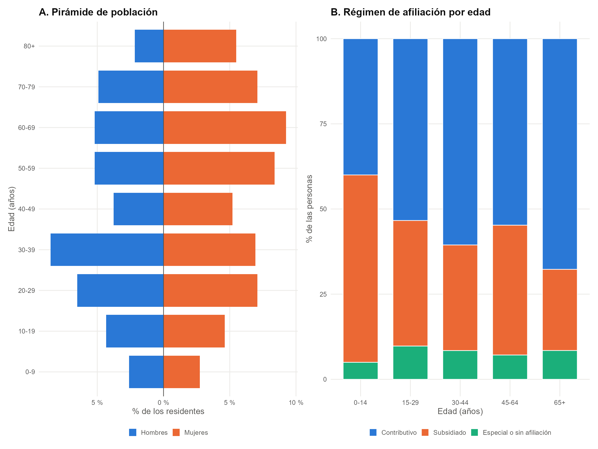
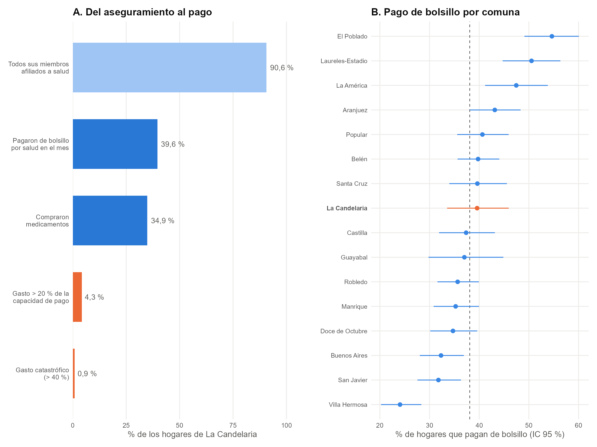
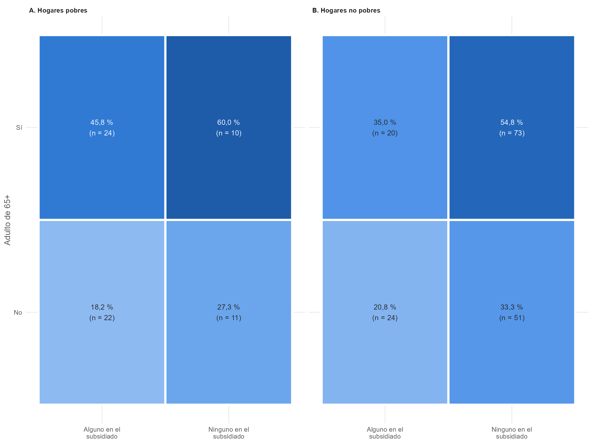

# Datos

## Fuente y unidad de análisis

Se usa exclusivamente la ECV de Medellín 2025. Cada registro es una persona; la encuesta identifica el hogar y su jefe. El análisis se hace por hogar, porque los gastos se reportan para el hogar completo, y las características de las personas se agregan por hogar. La muestra principal es La Candelaria (comuna 10).

| Módulo de la ECV | Información usada | Cómo entra al análisis |
|----|----|----|
| A. Identificación | Comuna (A.7), estrato (A.10), personas (A.14) | Muestra, per cápita y robustez |
| B. Composición | Orden en el hogar (B.1), sexo (B.2), edad (B.6) | Adultos de 65 años o más |
| F. Salud | Afiliación (F.1), enfermedad crónica (F.8) | Proporción en el subsidiado; control |
| H. Trabajo | Situación laboral (H.31), pensión (H.20) | Hogar sin ocupados |
| J. Vivienda | Tenencia (J.36) y gastos de vivienda (J.37 a J.52) | Consumo del hogar |
| K. Gastos | Gastos mensuales (K.1 a K.10) y anuales (K.12 a K.19) | Gasto en salud y consumo del hogar |

## La población de La Candelaria

Para entender el problema del gasto en salud, primero debemos mirar quiénes habitan esta zona. Al analizar los microdatos de la Encuesta de Calidad de Vida, encontramos que La Candelaria presenta una estructura demográfica particular.

{fig-align="center"}

Como se observa en la pirámide poblacional, existe una alta concentración de poblacón mayor en la comuna: la mitad de sus residentes tiene más de 47 años, el 27,3 % supera los 65 y solo el 8,7 % es menor de 15. Entre los adultos mayores, el 67,7 % está en el contributivo, que paga cuotas moderadoras y copagos, y el 23,8 % en el subsidiado. El 54,0 % de los hogares tiene al menos un adulto mayorEsto es fundamental para nuestro modelo, ya que el envejecimiento está directamente asociado con mayores necesidades de atención en salud.

## Del aseguramiento al pago

Tener un seguro médico no siempre garantiza protección financiera completa. En Colombia, el riesgo financiero varía significativamente según el régimen y los ingresos del hogar.

{fig-align="center"}

Los datos muestran un panorama revelador frente a esta transición: mientras que una abrumadora mayoría cuenta con afiliación teórica al sistema (90,6%), una proporción considerable (39,6%) termina realizando pagos de bolsillo. Sin embargo, muy pocos hogares llegan al nivel de gasto catastrófico. Esto nos indica que el problema principal no es la catástrofe financiera extrema, sino la desprotección del día a día.

## Características de los hogares: Pobres vs. No pobres

Al profundizar en las características de los hogares y su condición de pobreza, encontramos diferencias importantes en cómo enfrentan los gastos médicos.

{fig-align="center"}

Entre los hogares pobres con adultos mayores, paga de bolsillo el 60,0 % de los que no tienen a nadie en el subsidiado, frente al 45,8 % de los que sí. Estas cifras no controlan por otras características; el modelo lo hace

## El consumo del hogar

Para saber si un gasto en salud es grande frente a los recursos del hogar, primero hay que medir bien esos recursos. Se construye el consumo mensual del hogar con **todos los rubros de gasto de la ECV**, siguiendo las convenciones de Xu et al. (2003): se incluye el consumo y se excluyen los pagos de deuda y los impuestos, que no son consumo.

El arriendo estimado de quienes viven en vivienda propia (J.39) es clave: sin él, un propietario parecería más pobre que un arrendatario con el mismo nivel de vida. Incluir la vivienda también evita un error de medición que, con solo el módulo K, sobreestima de forma grave el gasto catastrófico de los hogares pobres.

## Capacidad de pago, gasto catastrófico y pago de bolsillo

**Pago de bolsillo (variable dependiente).** El gasto de bolsillo en salud es la suma de servicios médicos (K.6) y medicamentos (K.7) del último mes. El hogar *paga de bolsillo* si ese gasto es mayor que cero. Es la medida más directa de falta de protección financiera en un sistema de aseguramiento casi universal: todo pago es una parte de la atención que el seguro no cubrió.

**Capacidad de pago y gasto catastrófico.** Se sigue el método de Xu et al. (2003), adoptado por la Organización Mundial de la Salud.

## Hogares pobres

Un hogar es **pobre** si pertenece al 40 % de hogares de Medellín con menor consumo per cápita, sin contar el gasto en salud. Es una medida de pobreza *relativa*, construida solo con la ECV.

- **Por qué una medida relativa.** La pobreza monetaria oficial del DANE se calcula con el ingreso de otra encuesta y no puede replicarse con la ECV.
- **En qué se basa el 40 %.** Es el grupo con el que el Banco Mundial mide la prosperidad compartida.
- **Por qué consumo per cápita sin salud.** El consumo es una medida de bienestar más estable que el ingreso de un mes.
- **Por qué el corte se calcula con toda la ciudad.** Así "pobre" significa lo mismo en La Candelaria y en el resto de Medellín.
