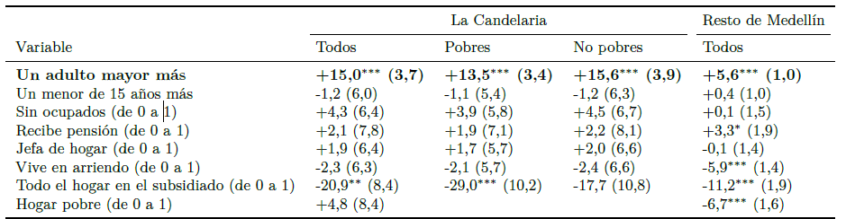

## Resultados de los Efectos Marginales

Efectos marginales promedio sobre la probabilidad de pagar de bolsillo (puntos porcentuales).

Errores estándar robustos entre paréntesis. Pobres y no pobres: efecto promedio dentro de cada grupo; para Hogar pobre no aplica. En La Candelaria, la diferencia entre pobres y no pobres es de -2,1 pp para Adultos mayores (p = 0,139) y de -11,3 pp para Subsidiado (p = 0,438). ∗∗∗ p < 0,01; ∗∗ p < 0,05; ∗ p < 0,1.

{fig-align="center"}

La Tabla de efectos marginales reporta los coeficientes del modelo principal, estimado con los hogares de La Candelaria (columna 1), y del mismo modelo en las otras 15 comunas (columna 2). El coeficiente de Adultos mayores es positivo y significativo en ambas. Como en un probit los coeficientes no miden magnitudes, la interpretación se hace con los efectos marginales.

# Discusión

El gasto catastrófico es raro (0,9 %); el pago de bolsillo es frecuente (39,6 %). Casi todos los hogares de La Candelaria están afiliados y, aun así, cuatro de cada diez pagan por salud en un mes. Es la distancia entre cobertura y protección financiera que documentan Wagstaff et al. (2018) en 133 países: el aseguramiento evita los pagos muy grandes, pero no evita los pagos frecuentes y moderados.

Cada adulto mayor eleva la probabilidad de pagar. El efecto de la edad, 13,9 pp por cada adulto mayor en los hogares pobres, coincide con lo encontrado en América Latina (Knaul et al., 2011) y en Colombia (Pérez-Valbuena & Silva-Ureña, 2015). El canal es el esperado: los hogares con adultos mayores compran medicamentos con mucha más frecuencia, un gasto recurrente asociado a enfermedades crónicas.

El subsidiado se asocia con menor probabilidad de pagar. La menor probabilidad de pagar en los hogares del subsidiado coincide con Pérez-Valbuena y Silva-Ureña (2015), que también modelan la probabilidad de algún gasto, y es coherente con la exención de cuotas moderadoras y copagos (Decreto 1652 de 2022).

Los hogares sin ocupados no pagan con más frecuencia. No aparece el efecto de la ocupación que reporta Amaya-Lara (2016). La falta de ocupados refleja sobre todo la edad, que ya está en el modelo.

Los hogares pobres pagan con menos frecuencia y montos más bajos, como en Cartagena (Alvis-Zakzuk et al., 2018). Esto puede reflejar tanto la exención del subsidiado, al que pertenecen con más frecuencia, como atención a la que se renuncia.

Con solo el módulo K, el gasto catastrófico parecería del 23 %. Con solo el módulo K, que omite la vivienda y los gastos anuales, el gasto catastrófico se multiplicaría por 26. El resultado confirma la advertencia de Cylus et al. (2018) sobre el peso del método y la amplía.
